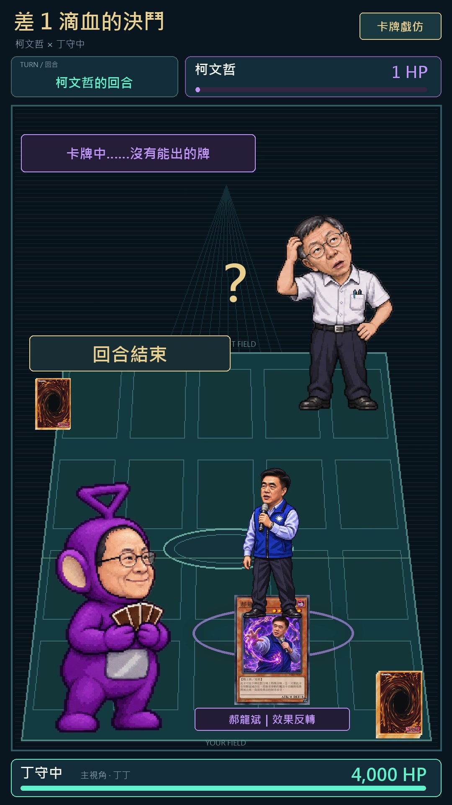
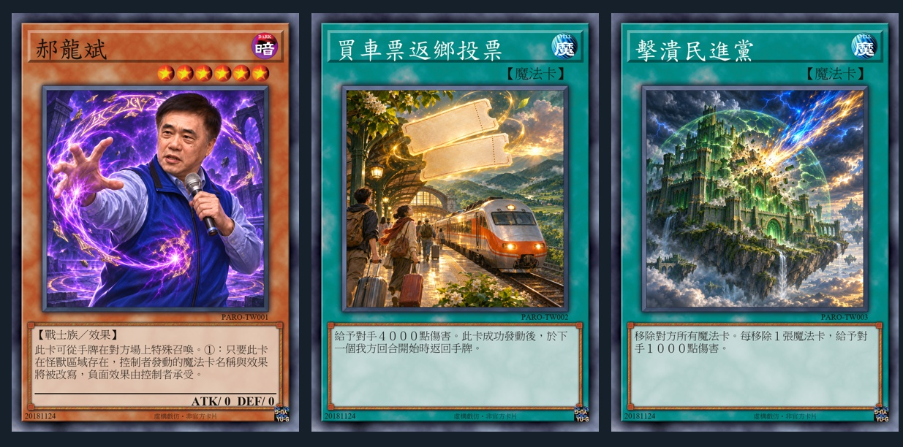

# 遊戲王式卡牌對戰 Short

把影片原音、金句或指定劇情，製作成 **放大決鬥場＋像素人物＋實卡式卡面** 的 9:16 卡牌對戰短片。預設採緊湊資訊列，底部僅留玩家 HP；原音字幕在發聲期間顯示於場內空隙。這是一個 Codex skill，包含製作流程、視覺規格、工程範本與兩個合成輔助工具。





## 安裝與使用

將此 repo 放進 Codex 的 skills 目錄。尚未安裝時，可在 PowerShell 執行：

```powershell
git clone https://github.com/weber87na/url-to-yugioh-duel-short.git "$env:USERPROFILE/.codex/skills/url-to-yugioh-duel-short"
```

若設定了 `CODEX_HOME`，則放到該目錄下的 `skills/url-to-yugioh-duel-short`。既有同名資料夾請先保留，不要直接覆蓋。

在 Codex 叫用：

```text
用 $url-to-yugioh-duel-short，把這段影片做成遊戲王式對戰。
主角是……，對手是……，最後神抽……逆轉。
```

也可修改既有成片，例如換卡背、修正人物殘手，或保留畫面與原音、只更換配樂。

## 內容

- [SKILL.md](SKILL.md)：技能入口與製作／修改流程。
- [視覺規格](references/visual-system.md)：放大場景座標、緊湊 HP、等比例人物、臨時字幕與動作。
- [卡面規格](references/card-style.md)：橙褐效果怪獸、青綠通常魔法、完整欄位、清晰繁中排版與統一卡背。
- [製作流程](references/production.md)：來源查核、時間軸、工程與成片驗收。
- [音訊流程](references/audio.md)：原音、純音效、配樂分軌，以及神抽對拍與台詞 duck。
- [目前案例](references/current-case.md)：柯文哲對丁守中 v5 的場景、卡面與驗收；[事件總覽](assets/scene-sequence-reference.jpg)。
- [早期案例](references/proven-case.md)：韓國瑜對王世堅的剪輯、來源與修正經驗。
- [工程範本](assets/duel-project.example.json)：可換角色、卡牌、勝負與片長的規劃契約。

此 repo **沒有通用的一鍵影片 renderer**。Codex 依 skill 統籌素材判讀、ImageGen 和本案合成；工程範本需補入可用素材與經核對時間軸。

## 輔助工具

Python 3.10+，FFmpeg／FFprobe 須可由 PATH 找到。`mix_audio.py` 使用 Python 標準函式庫；人物姿勢工具另需 Pillow、NumPy、OpenCV：

```powershell
python -m pip install -r requirements.txt
python -X utf8 scripts/mix_audio.py --help
python -X utf8 scripts/mix_audio.py path/to/mix.json
```

- `scripts/mix_audio.py`：依 JSON 混合對白、音效與配樂，原速分段、crossfade、duck、限幅；視訊 stream-copy，輸出分軌與來源紀錄。
- `scripts/sprite_tools.py`：供 renderer 匯入，按已確認連通元件隔離姿勢，保留透明柔邊與指定分離道具，排除鄰格殘肢。

完整製作另需要原生 ImageGen、可用下載工具（例如 yt-dlp），以及來源缺字幕時可用的轉錄工具。先檢查既有環境，不強制重新安裝整套依賴。

## 素材與驗證

參考圖是已完成戲仿作品的場景與卡面縮圖，人物與故事只作案例。圖片來源見 [style-reference-sources.json](assets/style-reference-sources.json)；卡框、字型來源紀錄及原始 notices 見[卡面規格](references/card-style.md)。早期原音、卡圖與曲目來源見[早期案例](references/proven-case.md)。完整音樂、下載影片、原始人物圖集、成片及原始模板字型二進位未收錄於 repo。

建立 skill 時已驗證：混音保留相同視訊 bitstream、duck 時間與倍率正確、limiter 無時間偏移；姿勢隔離保留指定人物與道具並排除外來元件。每次新作品仍需依流程驗收實際 MP4。
